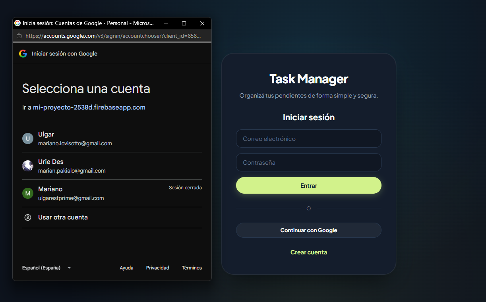
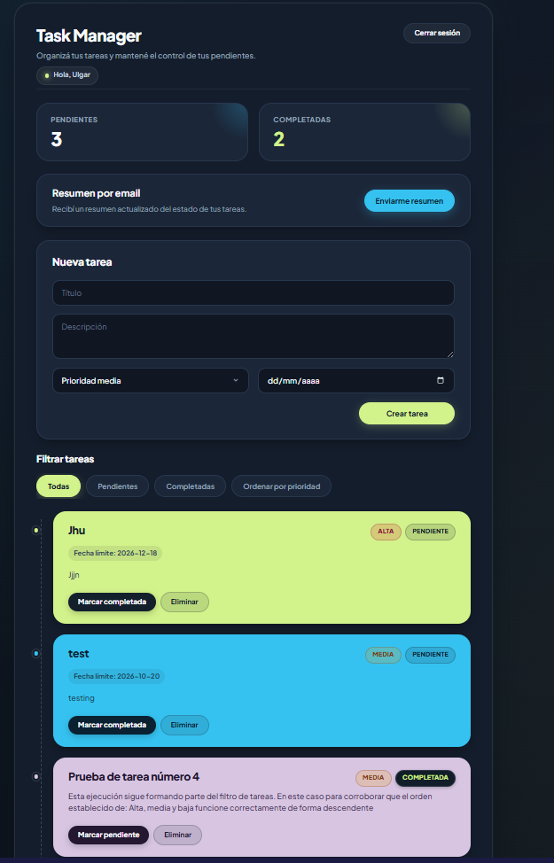
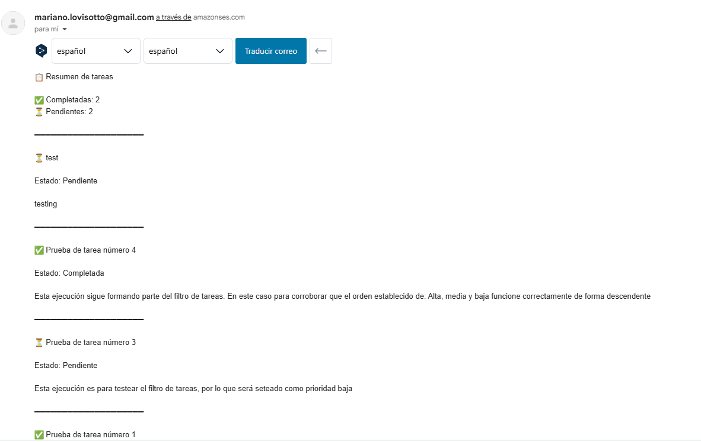
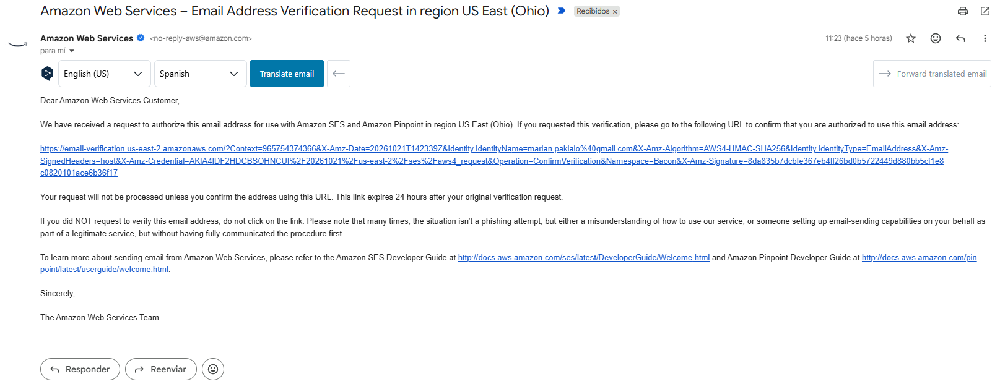

# 📋 Task Manager - Gestor de Tareas Fullstack

Aplicación web moderna y responsiva para la gestión y seguimiento de tareas en tiempo real. Desarrollada con **React 19**, **TypeScript**, **Vite**, **Firebase** (Authentication y Firestore) y una arquitectura serverless en **Vercel** integrada con **Amazon Web Services (AWS SES)** para el envío automático de reportes por correo electrónico.

---

## 🚀 Demo en Vivo

El proyecto se encuentra desplegado y listo para probar en Vercel:
👉 **[task-manager-sigma-fawn-97.vercel.app](https://task-manager-sigma-fawn-97.vercel.app/)**

---

## 📸 Capturas de Pantalla

### 1. Inicio de Sesión y Registro
Acceso seguro mediante autenticación de usuarios y validación de credenciales.


### 2. Dashboard Principal
Visualización de métricas en vivo, creación de tareas con prioridades y fechas, filtros interactivos y ordenamiento.


### 3. Solicitud y Recepción del Resumen por Email
Formato claro y estructurado con el balance de tareas completadas y pendientes enviado a través de AWS SES.


### 4. Flujo de Verificación de Email en AWS SES
Notificación y correo de confirmación enviado automáticamente a usuarios externos en modo Sandbox.


---

## ✨ Funcionalidades Principales

- **🔐 Autenticación y Autorización**:
  - Registro e inicio de sesión seguro con Firebase Authentication.
  - Protección de rutas privadas (`ProtectedRoute`) y persistencia de sesión de usuario.
- **📝 Gestión de Tareas (CRUD en tiempo real)**:
  - Creación de tareas con título, descripción detallada, nivel de prioridad (Alta, Media, Baja) y fecha límite.
  - Marcado de tareas como completadas o pendientes con sincronización instantánea en Cloud Firestore.
  - Eliminación individual de tareas con confirmación visual.
- **🔍 Filtros y Ordenamiento**:
  - Filtrado ágil por estado: *Todas*, *Pendientes* y *Completadas*.
  - Ordenamiento dinámico según el nivel de prioridad.
  - Indicadores numéricos de estado (tareas pendientes vs. completadas).
- **✉️ Notificaciones y Resumen por Email (AWS SES + Vercel Functions)**:
  - Endpoint Serverless que compila el estado actual de las tareas y envía un email formateado con la lista de pendientes y completadas.
  - **Manejo inteligente de AWS SES Sandbox**: si un usuario externo solicita el resumen por primera vez, el backend dispara automáticamente la solicitud de verificación a AWS sin intervención manual en la consola, notificando al usuario para que confirme su correo.

---

## 🛠️ Tecnologías Utilizadas

| Capa | Tecnologías |
| :--- | :--- |
| **Frontend** | React 19, TypeScript, Vite, CSS3 moderno (Glassmorphism, Dark Theme, Flexbox/Grid) |
| **Backend & Serverless** | Vercel Serverless Functions (Node.js runtime con TypeScript), `@aws-sdk/client-ses`, `@vercel/node` |
| **Base de Datos & Auth** | Google Firebase (Authentication & Cloud Firestore) |
| **Cloud & Hosting** | Vercel (Hosting & Serverless Deployment), AWS SES (Simple Email Service), AWS IAM |
| **Testing & Calidad** | Vitest, React Testing Library, JSDOM, Oxlint |

---

## 📁 Estructura del Proyecto

```text
ProyectoM4_MarianoLovisotto/
├── task-manager/                    # Directorio principal de la aplicación
│   ├── api/                         # Serverless Functions (Vercel Backend)
│   │   └── send-task-summary.ts     # Endpoint de envío y verificación con AWS SES
│   ├── screenshots/                 # Capturas de pantalla para documentación
│   │   ├── login.png
│   │   ├── dashboard.png
│   │   ├── tasks-sumarrys.png
│   │   └── email-verification.png
│   ├── src/
│   │   ├── components/              # Componentes reutilizables de UI (TaskForm, TaskList, etc.)
│   │   ├── features/auth/           # Lógica y servicios de autenticación con Firebase
│   │   ├── hooks/                   # Custom hooks (useAuth, useTasks)
│   │   ├── pages/                   # Vistas principales (DashboardPage, LoginPage, RegisterPage)
│   │   ├── routes/                  # Protección de rutas privadas (ProtectedRoute)
│   │   ├── services/                # Conexiones externas (firebase.ts, email.service.ts)
│   │   ├── tests/                   # Pruebas unitarias y de integración (Vitest + RTL)
│   │   ├── types/                   # Definiciones e interfaces de TypeScript
│   │   ├── App.tsx                  # Componente raíz y control de vistas
│   │   ├── main.tsx                 # Punto de entrada de React
│   │   └── index.css                # Sistema de estilos globales y diseño visual
│   ├── .env                         # Variables de entorno locales (ignorado en Git)
│   ├── package.json                 # Scripts y dependencias del proyecto
│   ├── tsconfig.json                # Configuración raíz de TypeScript
│   ├── tsconfig.app.json            # Configuración de TypeScript para Frontend (DOM)
│   ├── tsconfig.node.json           # Configuración de TypeScript para Node.js y API
│   └── vite.config.ts               # Configuración del bundler Vite
└── README.md
```

---

## ⚙️ Instalación y Configuración Local

### 1. Clonar el repositorio
```bash
git clone https://github.com/MarianoLovisotto/ProyectoM4_MarianoLovisotto.git
cd ProyectoM4_MarianoLovisotto/task-manager
```

### 2. Instalar dependencias
```bash
npm install
```

### 3. Configurar variables de entorno
Crea un archivo `.env` en la raíz de `task-manager/` con las siguientes claves:

```env
# Configuración de Firebase (Frontend)
VITE_FIREBASE_API_KEY=tu_firebase_api_key
VITE_FIREBASE_AUTH_DOMAIN=tu_proyecto.firebaseapp.com
VITE_FIREBASE_PROJECT_ID=tu_proyecto_id
VITE_FIREBASE_STORAGE_BUCKET=tu_proyecto.firebasestorage.app
VITE_FIREBASE_MESSAGING_SENDER_ID=tu_sender_id
VITE_FIREBASE_APP_ID=tu_app_id

# Configuración de AWS SES (Backend Serverless)
AWS_REGION=us-east-2
AWS_ACCESS_KEY_ID=tu_aws_access_key
AWS_SECRET_ACCESS_KEY=tu_aws_secret_key
AWS_SES_FROM_EMAIL=tu_email_verificado_en_ses@ejemplo.com
```

### 4. Ejecutar el proyecto en desarrollo

- **Modo estándar (Frontend):**
  ```bash
  npm run dev
  ```
- **Modo completo con Serverless Functions (mediante Vercel CLI):**
  ```bash
  vercel dev
  ```

---

## 🧪 Pruebas y Control de Calidad

El proyecto cuenta con suites de pruebas unitarias y de componentes utilizando **Vitest** y **React Testing Library**:

- **Ejecutar todos los tests:**
  ```bash
  npm test
  # O ejecución única:
  npm run test -- --run
  ```
- **Ejecutar el linter (Oxlint):**
  ```bash
  npm run lint
  ```
- **Verificación de tipado y compilación (Build):**
  ```bash
  npm run build
  ```

---

## 🤖 Uso de Inteligencia Artificial en el Desarrollo

Durante el ciclo de desarrollo de esta aplicación, se utilizó pair programming asistido por Inteligencia Artificial para resolver desafíos arquitectónicos, depuración de errores y buenas prácticas:

1. **Resolución de tipado y entorno en Serverless Functions de TypeScript:**
   - *Consulta realizada:* Se presentaron errores de compilación con `@vercel/node` (`VercelRequest`, `VercelResponse`) y TypeScript marcaba como desconocido el objeto global `process` al intentar leer variables de entorno.
   - *Solución:* Instalación de `@vercel/node` como dependencia de desarrollo y reconfiguración de `tsconfig.node.json` para incluir la carpeta `api/`, permitiendo que el compilador asociara las definiciones de tipos de Node.js a las funciones serverless sin colisionar con la configuración del navegador de Vite.

2. **Integración y arquitectura de Firebase Auth y Firestore:**
   - *Consulta realizada:* Estructuración de los servicios de autenticación y persistencia de tareas en Firestore, asegurando la separación de responsabilidades y tipado estricto en los custom hooks (`useAuth`, `useTasks`).

3. **Superación de las limitaciones de AWS SES Sandbox de forma automatizada:**
   - *Consulta realizada:* Al intentar enviar resúmenes por correo a cuentas distintas de la principal, AWS rechazaba el envío con error 500 debido a las restricciones del modo Sandbox. Se requería evitar la verificación manual de cada usuario en la consola de AWS sin salir del modo Sandbox.
   - *Solución:* Implementación de un flujo inteligente en `api/send-task-summary.ts` utilizando `GetIdentityVerificationAttributesCommand` y `VerifyEmailIdentityCommand`. Si el correo del usuario no está verificado en SES, la API dispara de forma desatendida el email de verificación oficial de AWS y devuelve un mensaje intuitivo en el frontend para que el usuario confirme su casilla en un clic.

4. **Diagnóstico y corrección del despliegue en Vercel:**
   - *Consulta realizada:* Al desplegar el repositorio en Vercel, el build fallaba con el error `[UNRESOLVED_ENTRY] Cannot resolve entry module index.html`.
   - *Solución:* Identificación de la discrepancia entre la raíz del repositorio de GitHub y la subcarpeta del proyecto, resolviéndose mediante la configuración del **Root Directory** en `task-manager` dentro del panel de Vercel.

---

## 👤 Autor

* **Mariano Lovisotto**
* GitHub: [@MarianoLovisotto](https://github.com/MarianoLovisotto)
